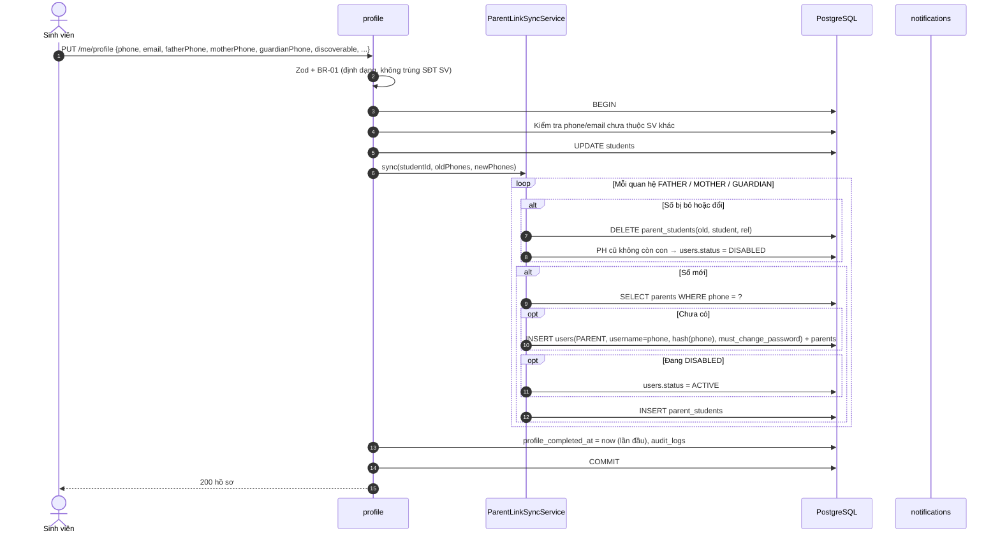
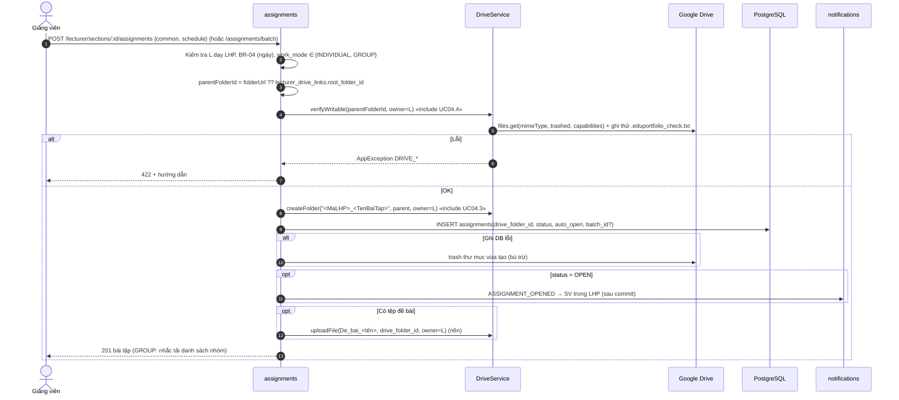
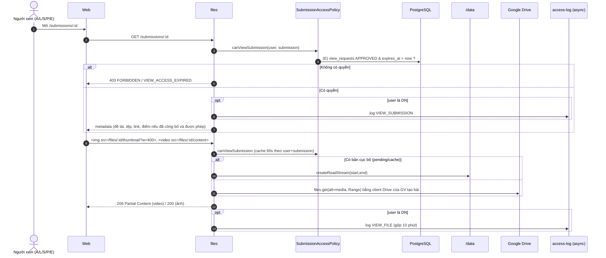
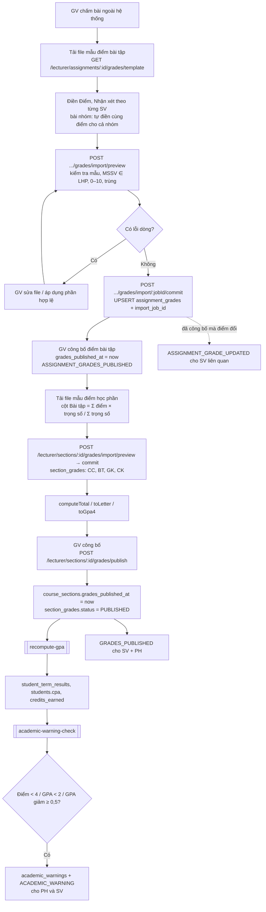
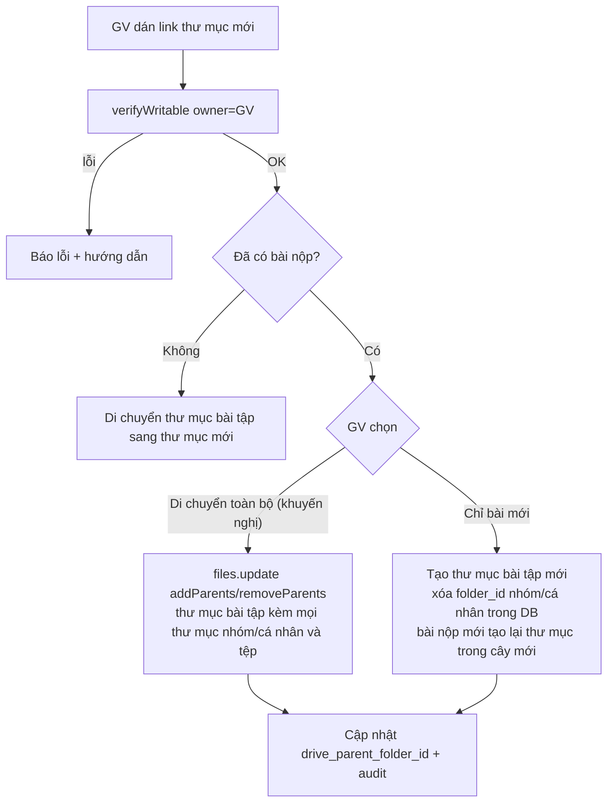
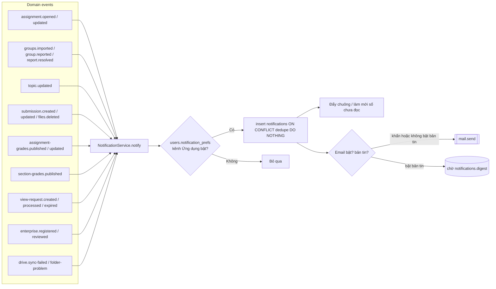

# EduPortfolio – Luồng xử lý giữa các module (Module Flows)

> Phiên bản 3.0 · 11/10/2026 · mọi tiến trình chạy trên Node.js 22 LTS
> **v3.0:** bỏ luồng SV lập nhóm/mời, chốt nhóm, duyệt đề tài, chấm bài, phúc khảo; thêm luồng liên kết Drive OAuth, tải danh sách nhóm và tải điểm bằng Excel.
> Quy tắc chi tiết nằm ở [Specification](Specification.md), tên module theo [ModulesStructure](ModulesStructure.md).

---

## 1. Đăng nhập, làm mới token, cổng chặn

```mermaid
sequenceDiagram
  autonumber
  actor U as Người dùng
  participant W as Web SPA
  participant A as auth
  participant DB as PostgreSQL
  participant R as Redis

  U->>W: Nhập tên đăng nhập + mật khẩu (tab Tài khoản / Phụ huynh)
  W->>A: POST /auth/login
  A->>R: Kiểm tra rate limit (IP+username)
  A->>DB: Tìm users theo lower(username), role phù hợp tab
  alt Sai mật khẩu
    A->>DB: failed_login_count++ (lần 5 → locked_until)
    A-->>W: 401 AUTH_INVALID_CREDENTIALS
  else Đúng
    A->>DB: Tạo refresh_tokens(hash, family_id), reset bộ đếm
    A-->>W: Set-Cookie access_token, refresh_token + {user, mustChangePassword, profileCompleted, children[]}
  end
  W->>W: Điều hướng: đổi mật khẩu → khai báo hồ sơ (SV) / chọn con (PH) → trang chủ vai trò

  Note over W,A: Access token hết hạn
  W->>A: Gọi API → 401 AUTH_TOKEN_INVALID
  W->>A: POST /auth/refresh (cookie)
  A->>DB: Tìm token_hash; đã revoked? → thu hồi cả family, 401
  A->>DB: Revoke token cũ, tạo token mới (replaced_by_id)
  A-->>W: Cookie mới → W gọi lại request ban đầu (một lần)
```

**Thứ tự guard trên mọi request:** `JwtAuthGuard` → `MustChangePasswordGuard` (trừ `/auth/change-password`, `/auth/logout`, `/auth/me`) → `ProfileCompleteGuard` (SV, trừ `/me/profile`) → `RolesGuard` → `ParentChildGuard` (route `/parent/*`).

## 2. Khai báo hồ sơ & đồng bộ tài khoản phụ huynh (UC03.1, UC03.3)



## 3. Liên kết Google Drive bằng OAuth (UC04.1)

```mermaid
sequenceDiagram
  autonumber
  actor L as Giảng viên
  participant W as Web
  participant DL as drive-link
  participant D as DriveService
  participant GA as Google OAuth
  participant G as Google Drive
  participant DB as PostgreSQL

  L->>W: Bấm "Liên kết tài khoản Google"
  W->>DL: GET /lecturer/drive/oauth/start
  DL->>DL: state ngẫu nhiên (gắn lecturerId, hạn 10')
  DL-->>W: URL đồng ý (scope drive.file + email, access_type=offline)
  W->>GA: Chuyển trang; GV chọn tài khoản, đồng ý
  GA-->>DL: GET /lecturer/drive/oauth/callback?code&state (cookie phiên của GV)
  DL->>DL: Kiểm tra state khớp GV, còn hạn
  DL->>GA: Đổi code → refresh token; userinfo.email
  DL->>DB: UPSERT lecturer_drive_links(OAUTH, google_email, refresh_token_enc = AES-256-GCM)
  opt Lần đầu liên kết
    DL->>D: createFolder("EduPortfolio_<MãGV>", 'root', owner=GV)
    D->>G: files.create(folder) bằng OAuth client của GV
    DL->>DB: root_folder_id, root_folder_name
  end
  DL-->>W: 302 /lecturer/drive?linked=1
```

`DriveService` chọn client theo **chủ bài tập** (`assignments.created_by`): GV có `refresh_token_enc` → `OAuth2Client` của GV (tự làm mới access token, lưu đệm theo GV); không có → Service Account (nếu cấu hình); không có cả hai → `DRIVE_NOT_LINKED`. Hủy liên kết: thu hồi token với Google, xóa liên kết, bỏ client lưu đệm.

## 4. Giao bài tập (UC04.2–UC04.4, UC04.8)



Bài `DRAFT` có `auto_open = true` được job `assignments.open-due` (mỗi phút) chuyển sang `OPEN` khi tới `open_at`. Giao nhiều LHP: lặp từng LHP, mỗi LHP một transaction và một thư mục, chung `batch_id`; trả kết quả từng LHP.

## 4a. Tải lên danh sách nhóm (UC05.1–UC05.3)

```mermaid
sequenceDiagram
  autonumber
  actor L as Giảng viên
  participant GR as groups
  participant X as ExcelService
  participant DB as PostgreSQL
  participant N as notifications

  L->>GR: GET /lecturer/assignments/:id/groups/template
  GR->>DB: SV của LHP + nhóm hiện có
  GR->>X: Sinh .xlsx (MSSV, Họ tên, Mã nhóm, Tên nhóm, Trưởng nhóm)
  GR-->>L: Tệp mẫu
  L->>GR: POST .../groups/import/preview (multipart .xlsx)
  GR->>X: Đọc sheet, chuẩn hóa ô
  GR->>DB: Đối chiếu MSSV ∈ LHP, nhóm hiện có, nhóm đã có bài chung/đề tài
  GR->>DB: INSERT import_jobs(ASSIGNMENT_GROUPS, PREVIEW, preview, errors)
  GR-->>L: Xem trước: nhóm Mới/Sửa/Giữ/Xóa, SV chuyển nhóm, SV chưa có nhóm, lỗi theo dòng
  L->>GR: POST .../groups/import/:jobId/commit
  GR->>DB: BEGIN; khóa bài tập (advisory lock)
  GR->>DB: UPSERT groups theo code; thay group_members; DELETE nhóm bị bỏ (chưa có bài chung/đề tài)
  GR->>DB: assignments.groups_imported_at = now; import_jobs = COMPLETED; audit; COMMIT
  GR->>N: GROUP_ASSIGNED / GROUP_REMOVED cho SV thay đổi (sau commit)
  GR-->>L: Danh sách nhóm mới
```

Thư mục Drive của nhóm không tạo khi tải danh sách mà tạo lười ở lần nộp đầu tiên (§5), nên tải lại danh sách nhiều lần không sinh thư mục rác. SV báo nhóm chưa đúng: `POST /student/assignments/:id/group-report` → `group_reports(OPEN)` → `GROUP_REPORTED` cho GV; GV `POST /lecturer/group-reports/:id/resolve` → `GROUP_REPORT_RESOLVED` cho SV.

## 5. Nộp bài & ghi lên Drive (UC06.1–UC06.4)

```mermaid
sequenceDiagram
  autonumber
  actor S as Sinh viên
  participant W as Web (Uppy)
  participant UP as uploads (tus)
  participant SB as submissions
  participant DB as PostgreSQL
  participant FS as /data
  participant QD as Queue drive
  participant WK as Worker
  participant G as Google Drive
  participant RT as realtime

  S->>W: Chọn tệp
  loop Mỗi tệp (chunk 5MB, tải tiếp được)
    W->>UP: POST/PATCH /uploads
    UP->>FS: ghi /data/uploads/tus/<id>
  end
  UP->>DB: uploads(status=COMPLETED, user_id)
  S->>W: Bấm "Nộp bài" (xác nhận nếu nộp lại)
  W->>SB: POST /assignments/:id/submissions {kind, uploadIds, figmaUrl, gitUrl, note, order}
  SB->>SB: Policy: thành viên nhóm/chủ bài, có nhóm (GROUP), có đề tài, trong hạn cuối
  SB->>FS: Đọc magic bytes từng tệp (file-type) + kiểm tra size/số lượng
  SB->>DB: BEGIN
  SB->>DB: pg_advisory_xact_lock(chủ bài); SELECT submission (nếu có)
  alt Nộp lần đầu
    SB->>DB: INSERT submissions(version=1)
  else Nộp lại «extend UC06.4»
    SB->>DB: deleted_at=now cho tệp cũ CÙNG LOẠI với tệp mới (loại khác giữ nguyên); version++
  end
  SB->>FS: move uploads → /data/pending/<submissionId>/
  SB->>DB: INSERT submission_files(PENDING); uploads=CONSUMED
  SB->>DB: submitted_at=now, is_late, status, sync_status=PENDING
  SB->>DB: INSERT submission_events(SUBMIT|RESUBMIT)
  SB->>DB: COMMIT
  SB->>QD: upload-file × n, trash-file × (tệp bị thay có drive_file_id)  (afterCommit)
  SB->>RT: emit group:<id> submission:updated
  SB-->>W: 201 "Nộp thành công – đang đồng bộ"

  QD->>WK: upload-file(fileId)
  WK->>DB: sync_status=UPLOADING
  WK->>WK: ensure-folder (khóa theo khóa thư mục) → folderId đích, client Drive của GV tạo bài
  WK->>G: resumable upload (chunk 8MB)
  alt Thành công
    WK->>DB: drive_file_id, drive_md5, SYNCED; local_path → /data/cache
    opt Mọi tệp của bài SYNCED
      WK->>DB: submissions.sync_status=SYNCED
    end
    WK->>RT: emit file:sync-status
  else Lỗi tạm thời
    WK-->>QD: thử lại (backoff tăng dần)
  else Lỗi vĩnh viễn / hết lần thử
    WK->>DB: FAILED, last_error, next_retry_at; submissions.sync_status=ERROR
    WK->>DB: notify GV SUBMISSION_SYNC_FAILED / DRIVE_FOLDER_PROBLEM (gộp theo giờ)
  end
```

**Đường đi của tệp:** `uploads` → `pending/<submissionId>` → (sau khi SYNCED) giữ bản cục bộ một thời gian để xem nhanh → xóa. Tệp `FAILED` ở lại `pending` đến khi đồng bộ được.

## 6. Xem bài & stream tệp (UC06.7, UC09.5–UC09.6)



## 7. Doanh nghiệp xin quyền xem bài (UC09)

```mermaid
sequenceDiagram
  autonumber
  actor E as Doanh nghiệp
  actor AD as Admin
  participant EN as enterprise
  participant AC as access-control
  participant DB as PostgreSQL
  participant N as notifications
  participant CR as Bộ hẹn giờ

  E->>EN: GET /enterprise/students/search?...
  EN->>DB: Truy vấn §6.2 DatabaseDesign; INSERT enterprise_search_logs
  EN-->>E: Danh sách SV (CPA ↓) + đề tài
  E->>EN: GET /enterprise/students/:id  «extend»
  EN->>DB: INSERT enterprise_access_logs(VIEW_PROFILE)
  E->>EN: POST /enterprise/view-requests {studentIds, purpose, days}  «extend»
  EN->>DB: Bỏ qua SV có yêu cầu PENDING/APPROVED; INSERT view_requests(PENDING)
  EN->>N: notify Admin VIEW_REQUEST_CREATED

  AD->>AC: POST /admin/view-requests/approve {ids, days}
  AC->>DB: status=APPROVED, approved_at=now, expires_at=now+days
  AC->>N: notify DN + SV VIEW_REQUEST_PROCESSED

  E->>EN: GET /enterprise/students/:id/submissions → xem bài (§6)

  loop Mỗi 5 phút
    CR->>AC: expireDue()
    AC->>DB: UPDATE ... SET EXPIRED WHERE expires_at <= now RETURNING
    AC->>N: notify DN VIEW_REQUEST_EXPIRED
  end
  Note over CR,AC: 08:00 hằng ngày: còn ≤ 48h → VIEW_REQUEST_EXPIRING (dedupe)
```

## 8. Lịch tác vụ nền (Bộ hẹn giờ)

Đăng ký trong `scheduler` module dưới dạng **BullMQ repeatable jobs** (múi giờ `Asia/Ho_Chi_Minh`), chỉ chạy trong tiến trình `worker`. Mỗi job idempotent và dùng khóa Redis để không chạy chồng.

| Job | Lịch (cron) | Use case | Việc làm |
|---|---|---|---|
| `assignments.open-due` | `* * * * *` | UC04.2 | `DRAFT` có `auto_open` và `open_at ≤ now` → `OPEN` + `ASSIGNMENT_OPENED` |
| `assignments.close-due` | `*/5 * * * *` | UC04.5 | Quá hạn cuối, `deadline_processed_at IS NULL` → ghi `deadline_processed_at` (không nhận bài nữa; không gửi cảnh báo) |
| `reminders.deadline` | `*/15 * * * *` | UC06.10 | Nhắc SV chưa nộp trước `reminder.hoursBefore` giờ (dedupe) |
| `drive.retry-failed` | `*/10 * * * *` | UC06.9 | Đưa lại tệp `FAILED` đến hạn thử |
| `drive.verify-files` | `0 3 * * *` | UC06.9 | Kiểm tra tệp còn trên Drive → `MISSING` |
| `drive.health-check` | `0 6 * * *` | UC04.4 | Kiểm tra thư mục bài tập đang mở còn quyền ghi / liên kết còn hiệu lực → `DRIVE_FOLDER_PROBLEM` |
| `imports.expire` | `0 * * * *` | UC05.2, UC07.2 | `import_jobs` `PREVIEW` quá 24 giờ → `CANCELLED`, xóa tệp tạm |
| `view-requests.expire` | `*/5 * * * *` | UC09.10 | `APPROVED` quá hạn → `EXPIRED` |
| `view-requests.expiring` | `0 8 * * *` | UC09.10 | Báo DN còn ≤ 48h |
| `maintenance.cleanup-uploads` | `0 * * * *` | – | Xóa `uploads` hết hạn chưa dùng |
| `maintenance.cleanup-cache` | `30 3 * * *` | – | Xóa cache tệp, thumbnail, báo cáo cũ |
| `maintenance.purge-logs` | `0 4 1 * *` | – | Dọn log/thông báo/token cũ (DatabaseDesign §8) |
| `stats.warmup` | `0 5 * * *` | UC10 | Tính sẵn dashboard Admin vào cache |
| `stats.topic-trends` | `30 1 * * *` | UC10.7–10.8 | Tính lại `topic_trend_snapshots` cho kỳ hiện tại và kỳ trước |
| `notifications.digest` | `*/15 * * * *` | UC11.4 | Gửi bản tin tổng hợp cho người dùng bật bản tin, đúng khung giờ |

Đã bỏ ở v3.0: `groups.lock-due`, `groups.lock-reminder`, `groups.lock-at-deadline`, `invitations.expire` (không còn chốt nhóm/lời mời); cảnh báo PH "quá hạn chưa nộp".

## 9. Tải điểm → công bố → GPA → cảnh báo (UC07)



## 10. Yêu cầu sửa điểm sau khi khóa (UC07.7–UC07.8)

```mermaid
sequenceDiagram
  autonumber
  actor L as Giảng viên
  actor AD as Admin
  participant GR as grading
  participant DB as PostgreSQL
  participant N as notifications
  participant Q as Queue grading

  L->>GR: POST /grade-change-requests {sectionGradeId, newValues, reason}
  GR->>DB: Kiểm tra LHP đã công bố, L phụ trách, chưa có PENDING
  GR->>DB: INSERT grade_change_requests(PENDING, old_values snapshot)
  GR->>N: notify Admin GRADE_CHANGE_REQUESTED
  AD->>GR: POST /admin/grade-change-requests/:id/approve
  GR->>DB: BEGIN; kiểm tra old_values = giá trị hiện tại (tránh ghi đè lệch)
  GR->>DB: UPDATE section_grades (tính lại total/letter/gpa4)
  GR->>DB: INSERT audit_logs(GRADE_CHANGED, old, new); status=APPROVED; COMMIT
  GR->>Q: recompute-gpa(studentId) → academic-warning-check
  GR->>N: notify GV + SV GRADE_CHANGE_PROCESSED
```

## 11. Đổi thư mục nhận bài khi đã có bài nộp (UC04.6)



## 12. Luồng sự kiện nội bộ → thông báo



## 13. Phân tích đề tài & bản tin thông báo

- `stats.topic-trends` (01:30): với kỳ hiện tại và kỳ trước, chạy truy vấn [DatabaseDesign §6.6](DatabaseDesign.md#66-phân-tích-cung--cầu-đề-tài-uc107) theo từng ngành → `INSERT ... ON CONFLICT DO UPDATE` vào `topic_trend_snapshots`. Đề tài chỉ gồm tên + từ khóa nên mọi số liệu tính theo từ khóa đã gộp.
- `notifications.digest` (mỗi 15'): lấy người dùng bật bản tin và giờ gửi trong khung → gom thông báo chưa gửi email → 1 email `NOTIFICATION_DIGEST` (nhóm theo loại, có link).
