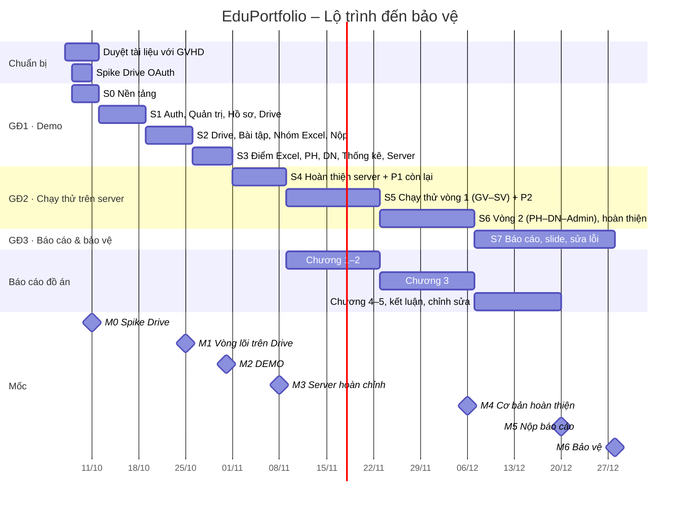

# EduPortfolio – Kế hoạch dự án (Project Plan)

> Phiên bản 3.0 · 11/10/2026 · **v3.0:** hệ thống chỉ **lưu trữ** kết quả học tập — GV lập nhóm và tải điểm bằng Excel, không chấm trên web, không theo dõi tiến độ; Drive dùng OAuth của GV · **Lịch: demo xong 31/10 → tháng 11 chạy thử trên server thật → cơ bản hoàn thiện 06/12 → bảo vệ cuối tháng 12/2026**
> Tài liệu điều phối chung, liên kết tới: [Requirement](Requirement.md) · [Specification](Specification.md) · [Architecture](Architecture.md) · [DatabaseDesign](DatabaseDesign.md) · [ModulesStructure](ModulesStructure.md) · [ModuleFlows](ModuleFlows.md) · [TechTasks](TechTasks.md)

---

## 1. Tổng quan

| Mục | Nội dung |
|---|---|
| Tên đề tài | Hệ thống quản lý kết quả học tập đa phương tiện của sinh viên (EduPortfolio) |
| Loại | Đồ án tốt nghiệp – ứng dụng web |
| Người dùng | Admin, Giảng viên, Sinh viên, Phụ huynh, Doanh nghiệp |
| Phạm vi | 11 nhóm use case (UC01–UC11), khoảng 90 use case con (v3.0: UC04.1–4.9, UC05.1–5.8, UC07.1–7.9) |
| Công nghệ | **Node.js 22 LTS + TypeScript** (nền tảng chính) · NestJS + Prisma · React + Vite (giao diện theo bộ mẫu `project/`) · PostgreSQL · ExcelJS · Google Drive API (OAuth của GV, Service Account tùy chọn) · Docker Compose |
| Thời gian | 08/10/2026 – bảo vệ cuối tháng 12/2026 (~12 tuần, 3 giai đoạn, 8 sprint) |
| Nguồn lực | 1 sinh viên thực hiện + trợ lý AI viết code; 1 giảng viên hướng dẫn (GVHD); 1 VPS làm server chạy thật |

### 1.1. Ba giai đoạn

| Giai đoạn | Thời gian | Kết quả phải có |
|---|---|---|
| **1. Xây dựng demo** | 08/10 – 31/10 | Bản demo chạy đủ luồng chính của 11 nhóm use case trên server thật (VPS, có HTTPS), dùng Google Drive thật (OAuth của GV) |
| **2. Chạy thử trên server thật** | 01/11 – 06/12 | Hoàn thiện P2 và kiểm thử toàn bộ hệ thống ngay trên server (dữ liệu seed, kịch bản theo vai trò), cộng test tự động, bảo mật, hiệu năng. **06/12: cơ bản hoàn thiện, đóng băng tính năng** |
| **3. Báo cáo & bảo vệ** | 07/12 – cuối 12 | Báo cáo đồ án, slide, video dự phòng; chỉ sửa lỗi |

### 1.2. Mục tiêu

1. **31/10:** demo đủ luồng chính (mục §3.1), chạy trên server thật với Drive thật.
2. **08/11:** server có CI tự deploy, email thật, dữ liệu kiểm thử đầy đủ.
3. **06/12:** đủ 11 nhóm use case (P1 + P2), đạt Definition of Done đầy đủ, không còn lỗi Nghiêm trọng/Cao.
4. Có số liệu chạy thử trên server (kết quả từng kịch bản, tỉ lệ đồng bộ Drive thành công, thời gian phản hồi, kết quả đo tải) để đưa vào chương 5 của báo cáo.
5. Test tự động: unit + API e2e (≥ 70% coverage ở service lõi) + 8 kịch bản E2E UI trước 06/12.

### 1.3. Sản phẩm bàn giao

| # | Sản phẩm | Hạn |
|---|---|---|
| D1 | Bộ tài liệu phân tích – thiết kế (thư mục `docs/`) | 11/10/2026 (bản 3.0), cập nhật liên tục |
| D2 | Mã nguồn monorepo trên GitHub (private, mời GVHD) | Liên tục |
| D3 | Bản demo trên server thật (URL HTTPS) + tài khoản demo | **31/10/2026** |
| D4 | Server hoàn chỉnh: CI tự deploy, email thật, backup | 08/11/2026 |
| D5 | Biên bản chạy thử trên server (kịch bản, kết quả, lỗi đã sửa, số liệu) | 06/12/2026 |
| D6 | Bản `v1.0.0-rc` (đóng băng) + hướng dẫn sử dụng + hướng dẫn cài đặt | **06/12/2026** |
| D7 | Báo cáo đồ án (Word/PDF) | Theo hạn của khoa (dự kiến ~20/12/2026) |
| D8 | Slide bảo vệ + video demo dự phòng | Trước ngày bảo vệ 3 ngày |

## 2. Giả định & ràng buộc

| # | Giả định / Ràng buộc | Nếu sai thì |
|---|---|---|
| A1 | Tháng 10 làm **~47 giờ/tuần** và dùng trợ lý AI cho phần code lặp lại; ước lượng 270 giờ thủ công rút xuống còn ~165 giờ thực tế | Áp dụng danh sách cắt giảm demo §3.3 ngay cuối S1 (18/10) |
| A2 | Có Google Cloud project với Drive API + OAuth client; Gmail của GV được thêm vào *Test users* | Dùng Service Account + Shared Drive nếu trường cấp Workspace |
| A3 | Có VPS (≥ 2 vCPU, 4 GB RAM) + tên miền trước 26/10 | Dùng máy cá nhân + Cloudflare Tunnel cho demo |
| A4 | Không cần môi trường production riêng hay người dùng thật; chạy được và kiểm thử đầy đủ trên server thật là đủ cho báo cáo | Nếu GVHD yêu cầu người dùng thật thì mời vài bạn cùng khóa đóng vai, vẫn trên server này |
| A5 | GVHD duyệt bộ tài liệu này làm phạm vi chính thức trước 11/10 | Cập nhật Requirement + TechTasks, đánh giá lại tiến độ |
| A6 | GV chấm ngoài hệ thống, tải điểm bằng Excel; không tích hợp phần mềm đào tạo | – |
| A7 | Hạn nộp báo cáo khoảng 20/12, bảo vệ khoảng 28–31/12 | Chương 1–3 đã viết từ tháng 11 nên co lại được 1 tuần |

## 3. Phạm vi theo mốc

### 3.1. Có trong demo 31/10

| Nhóm | Phạm vi demo | Để sang tháng 11 |
|---|---|---|
| UC01 | Đăng nhập (2 kiểu), đổi mật khẩu lần đầu và thường, đăng xuất, đăng ký DN, PH chọn con | Quên mật khẩu |
| UC02 | Danh mục, học kỳ/môn, LHP + trùng lịch, tài khoản GV/SV, xếp SV (chọn tay), duyệt DN | Import Excel SV/LHP, quản lý PH + đổi SĐT, nhật ký, cấu hình (giao diện) |
| UC03 | Toàn bộ | – |
| UC04 | Liên kết Drive (OAuth của GV), giao bài cho một hoặc nhiều LHP (kiểm tra quyền + tạo thư mục), tệp đề bài, sửa/đóng/xóa, SV nhận bài tập | Đổi thư mục nhận bài, đổi tên thư mục, chế độ Service Account |
| UC05 | GV tải file mẫu + tải lên danh sách nhóm (xem trước, lỗi dòng, áp dụng); SV xem nhóm; nhập đề tài + từ khóa, cảnh báo trùng | Báo nhóm chưa đúng, xuất Excel nhóm, lịch sử tải lên |
| UC06 | Nộp chung/cá nhân, ghi Drive, nộp lại (thay theo loại tệp), xóa nhiều tệp, trình xem ảnh/video/Figma/PDF, GV xem danh sách bài đã nộp | Real-time (demo dùng polling), lịch sử nộp, **tìm kiếm bài nộp**, đồng bộ lại định kỳ, nhắc hạn |
| UC07 | Tải điểm bài tập (Excel) + công bố; tải điểm học phần (Excel), tính tổng kết, công bố, GPA/CPA, SV xem điểm | Xuất Excel bảng điểm, yêu cầu sửa điểm sau khóa + Admin xử lý |
| UC08 | Chọn con, điểm/GPA/CPA, bài nộp | Cảnh báo học tập |
| UC09 | Tìm SV, hồ sơ, gửi yêu cầu, trạng thái, Admin duyệt/từ chối/thu hồi, tự hết hạn, DN xem bài + nhật ký | SV xem DN đã xem mình |
| UC10 | Dashboard Admin, thống kê LHP (kết quả) | Thống kê DN, SV, DN mình, xuất báo cáo, phân tích đề tài, bản đồ năng lực |
| UC11 | Chuông (polling), thông báo tự động trong ứng dụng, trang thông báo + cài đặt | Email thật (demo dùng Mailpit), bản tin 20:00 |

### 3.2. Hoàn thiện trong tháng 11 (đến 06/12)

Tất cả mục ở cột "Để sang tháng 11" + test e2e đầy đủ + bảo mật + hiệu năng + UI/UX theo lỗi phát hiện khi chạy thử. Chi tiết theo sprint ở [TechTasks](TechTasks.md) (S4–S6).

### 3.3. Thứ tự cắt giảm khi trễ

**Cho demo 31/10** (kiểm tra cuối S1 ngày 18/10 và cuối S2 ngày 25/10): nếu chậm hơn 20% thì đẩy sang tuần đầu tháng 11 lần lượt từ trên xuống:
1. T-312 giao nhiều LHP (4h); demo tạo bài từng LHP
2. T-603 Thống kê LHP (6h)
3. T-601 Dashboard Admin (6h); demo nói miệng phần thống kê
4. T-407 Job hạn nộp (2h); demo bằng nút "Đóng bài tập" thủ công
6. T-201a Xếp SV chọn tay (3h); seed sẵn SV vào LHP
7. T-109 phần giao diện xung đột lịch (giữ API + test)
8. T-504 rút gọn bộ lọc tìm SV (chỉ ngành, khóa, tag, CPA)

**Luồng không được cắt:** đăng nhập → hồ sơ + PH → liên kết Drive + giao bài → tải file nhóm → SV nhập đề tài → nộp bài → GV xem bài → tải điểm + công bố → PH xem → DN xin quyền và xem.

**Cho mốc 06/12** (nếu tháng 11 trễ): 1. Bản đồ năng lực DN (T-612) · 2. Bản tin thông báo (giữ trang thông báo) · 3. Xuất PDF (giữ Excel) · 4. Chế độ Service Account (giữ OAuth) · 5. Đổi thư mục khi đã có bài nộp · 6. Thống kê DN chi tiết (giữ 5 chỉ số) · 7. `verify-files`/`health-check` · 8. Báo nhóm chưa đúng · 9. Cảnh báo `GPA_DROP`. Phân tích đề tài **không cắt**.

## 4. Phương pháp làm việc

- **Sprint 1 tuần** trong tháng 10 (nhịp nhanh để phát hiện trễ sớm), **sprint 1–2 tuần** từ tháng 11.
- **Bảng công việc:** GitHub Projects (*Backlog → Sprint → Đang làm → Review → Xong*); mỗi task ở [TechTasks](TechTasks.md) là một issue, nhãn `UC0x`, `P1/P2`, `be/fe/infra`, `server-test`.
- **Làm việc với trợ lý AI:** giao từng task kèm đường dẫn tới mục tài liệu tương ứng (Specification/DatabaseDesign/ModulesStructure); người thực hiện review code, chạy test, thử trên giao diện trước khi đánh dấu xong.
- **Mỗi tối Chủ nhật:** tự demo trên máy hoặc server, cập nhật burndown, quyết định cắt giảm nếu cần (§3.3).
- **GVHD:** gửi báo cáo tuần (mẫu §12.2) mỗi Chủ nhật trong tháng 10; họp trực tiếp 18/10, 31/10 (demo), 22/11, 06/12.
- **Nhánh git:** `main` luôn deploy được ← `feature/<task-id>-<mô-tả>`; server chạy bản `main` mới nhất. Người thực hiện tự commit.
- **Phiên bản:** `v0.1.0` (demo 31/10), `v0.2.x` (chạy thử tháng 11), `v1.0.0-rc` (06/12), `v1.0.0` (sau bảo vệ).

## 5. Lộ trình

### 5.1. Biểu đồ Gantt



### 5.2. Chi tiết từng sprint

#### Chuẩn bị (07/10 – 11/10)
- Gửi bộ tài liệu cho GVHD, chốt câu hỏi §13 (đặc biệt Q1, Q7).
- **Spike Drive (T-000), phải xong trước 11/10:** GCP project → Drive API → OAuth client + Test user → GV liên kết → tải thử tệp 50 MB.

#### Giai đoạn 1 – Demo

| Sprint | Thời gian | Mục tiêu | Task | Tự kiểm cuối sprint |
|---|---|---|---|---|
| S0 | 08/10 – 11/10 | Khung dự án, schema đủ bảng | T-000 – T-007 | `pnpm dev` chạy; OAuth ghi được Drive |
| S1 | 12/10 – 18/10 | Đăng nhập mọi vai trò, dữ liệu nền, hồ sơ → PH, hạ tầng Drive | T-101–T-110 (trừ T-104), T-204, T-206, T-207, T-209, T-210 | SV khai báo hồ sơ thì PH đăng nhập được; **họp GVHD 18/10** |
| S2 | 19/10 – 25/10 | Vòng lõi trên Drive thật | T-211, T-212, T-301–T-306, T-308–T-310, T-312, T-401, T-403, T-404 | **M1:** liên kết Drive → giao bài → file nhóm → đề tài → nộp → Drive → xem trình chiếu |
| S3 | 26/10 – 31/10 | Điểm bằng Excel, PH, DN, thống kê cơ bản, triển khai lên server | T-201a, T-407, T-408, T-409a, T-410, T-503a, T-504–T-507, T-601, T-603, T-609, T-311 | **M2 – DEMO 31/10** theo kịch bản §11 trên server |

#### Giai đoạn 2 – Chạy thử trên server thật

| Sprint | Thời gian | Mục tiêu | Task |
|---|---|---|---|
| S4 | 01/11 – 08/11 | CI tự deploy + email thật + import + tìm bài + sửa điểm; chuẩn bị dữ liệu và kịch bản chạy thử | T-008, T-703, T-111, T-201b, T-205, T-104, T-202, T-203, T-406, T-501, T-712 |
| S5 | 09/11 – 22/11 | **Chạy thử vòng 1** (vai GV + SV); real-time; độ bền Drive; P2; test e2e; báo cáo chương 1–2 | T-402, T-405, T-409b, T-502, T-503b, T-208, T-508, T-509, T-510, T-511, T-307, T-702, T-713a, T-706a |
| S6 | 23/11 – 06/12 | **Chạy thử vòng 2** (vai PH + DN + Admin); thống kê, phân tích đề tài, bản tin; bảo mật, hiệu năng, UI; E2E; báo cáo chương 3 | T-602, T-604 – T-608, T-610, T-611, T-612, T-515, T-701, T-705, T-713b, T-706b |

#### Giai đoạn 3 – Báo cáo & bảo vệ (07/12 – cuối 12)
- Chỉ sửa lỗi (T-714), không thêm tính năng.
- Hoàn thành báo cáo chương 4–5 (T-706c), nộp theo hạn khoa (~20/12).
- Slide, video dự phòng, bản chạy local (T-707); 2 lần tổng duyệt (T-715).

### 5.3. Kế hoạch chạy thử trên server thật (tháng 11)

Không dựng production riêng và không mời người dùng thật. Mọi thứ chạy trên **một VPS** (chính server dùng cho demo 31/10), với dữ liệu seed sát thực tế và Google Drive thật của GV (OAuth). Người thực hiện tự đóng các vai bằng nhiều trình duyệt / cửa sổ ẩn danh; ở kịch bản nhóm có thể nhờ vài bạn đóng vai SV nếu muốn.

| Tuần | Thời gian | Vai | Hoạt động | Số liệu ghi lại |
|---|---|---|---|---|
| 0 | 01/11 – 08/11 | – | Bật CI tự deploy lên server, SMTP thật, backup; seed bộ dữ liệu kiểm thử (2 học kỳ, ~120 SV, 6 GV); viết checklist kịch bản theo §14 | – |
| 1–2 | 09/11 – 22/11 | GV, SV | Tạo 2 bài tập (1 nhóm, 1 cá nhân, có ảnh + video lớn + báo cáo); tải file nhóm (kể cả file có lỗi, tải lại khi đã có bài nộp); SV nhập đề tài, nộp, nộp lại, xóa ảnh; cố ý gây lỗi Drive (hủy liên kết OAuth) để kiểm tra giữ tạm và đồng bộ lại; tải điểm, công bố | Kết quả từng kịch bản (đạt/lỗi), tỉ lệ tệp `SYNCED` lần đầu, số lần thử lại, thời gian upload video 300–500 MB, p95 thời gian phản hồi |
| 3 | 23/11 – 29/11 | PH, DN, Admin | PH đăng nhập bằng SĐT, xem điểm/bài/cảnh báo; DN đăng ký → tìm → xin quyền → duyệt → xem → hết hạn (rút ngắn thời hạn); yêu cầu sửa điểm; thống kê, xuất báo cáo | Kết quả kịch bản; đối chiếu số liệu thống kê với truy vấn kiểm tra |
| 4 | 30/11 – 06/12 | Tất cả | Chạy lại 8 kịch bản E2E trên server; đo tải k6; sửa lỗi còn lại; chốt `v1.0.0-rc` | Biên bản chạy thử (D5) |

**Quy tắc khi chạy thử:** lỗi ghi thành issue nhãn `server-test`; backup DB trước mỗi lần deploy có migration; lưu ảnh chụp màn hình và số liệu cho chương 5.

## 6. Mốc kiểm soát

| Mốc | Ngày | Tiêu chí đạt | Nếu không đạt |
|---|---|---|---|
| M0 Spike Drive | 11/10 | GV liên kết OAuth và tải được tệp 50 MB vào thư mục ứng dụng tạo | Dùng Service Account + Shared Drive; báo GVHD |
| Kiểm S1 | 18/10 | Đăng nhập mọi vai trò, dữ liệu nền, hồ sơ → PH | Áp dụng cắt giảm demo §3.3 mục 1–2 |
| M1 | 25/10 | Vòng giao bài → file nhóm → đề tài → nộp → Drive → xem chạy được | Cắt §3.3 mục 1–4; S3 chỉ còn điểm, PH, DN |
| **M2 DEMO** | **31/10** | Kịch bản §11 chạy trên server thật (trừ phần đã cắt giảm có ghi rõ) | Demo trên máy local; phần thiếu xong trong tuần 01–08/11 |
| M3 | 08/11 | CI tự deploy lên server, email thật, import, dữ liệu và checklist chạy thử sẵn sàng | Bắt đầu chạy thử muộn nhất 16/11 |
| **M4 Cơ bản hoàn thiện** | **06/12** | Đủ 11 nhóm UC; TC-01 – TC-24 xanh; 8 E2E xanh; không còn lỗi Nghiêm trọng/Cao; có biên bản chạy thử | Cắt theo §3.3 (mốc 06/12), phần còn lại ghi vào "hướng phát triển" |
| M5 | ~20/12 | Nộp báo cáo đồ án | – |
| M6 | ~28/12 | Bảo vệ | – |

## 7. Quản lý rủi ro

Thang điểm: Xác suất (X) và Ảnh hưởng (A) từ 1 đến 3; Mức = X × A.

| # | Rủi ro | X | A | Mức | Phòng ngừa | Ứng phó |
|---|---|---|---|---|---|---|
| R1 | Liên kết OAuth bị chặn (GV không có trong *Test users*) hoặc refresh token hết hạn sau 7 ngày khi app còn *Testing* | 2 | 2 | 4 | Thêm Gmail GV vào Test users; hướng dẫn liên kết lại; cân nhắc *Publish app* (scope không nhạy cảm) | Tệp giữ tạm trên server, tự đồng bộ khi GV liên kết lại; dự phòng Service Account |
| R2 | **Không kịp demo 31/10** (270 giờ trong 3,5 tuần) | 3 | 3 | **9** | Sprint 1 tuần; kiểm burndown 18/10 và 25/10; dùng trợ lý AI cho CRUD/form/test; ưu tiên luồng không được cắt | Cắt theo §3.3; demo có ghi rõ phần đang làm; phần thiếu xong trước 08/11 |
| R4 | Deploy có migration làm hỏng dữ liệu chạy thử trên server | 1 | 2 | 2 | Backup trước mỗi deploy; thử migration trên DB local có dữ liệu seed trước | Khôi phục từ backup, seed lại |
| R5 | Quota/giới hạn tốc độ Drive API khi đo tải nhiều SV nộp cùng lúc | 2 | 2 | 4 | Hàng đợi có limiter, backoff, nộp bất đồng bộ | Tăng chu kỳ thử lại, phục vụ tệp từ bản cục bộ |
| R6 | Đầy ổ đĩa / băng thông VPS do video | 2 | 2 | 4 | Job dọn dẹp, cache 7 ngày, giới hạn video, cảnh báo Uptime Kuma | Giảm thời gian cache, nâng ổ đĩa, hạ giới hạn video |
| R7 | Lỗi bảo mật phân quyền (lộ bài cá nhân, DN xem quá hạn) trên server công khai | 2 | 3 | **6** | Policy tập trung + test bảng chân trị **trong tháng 10**; kiểm tra `expires_at > now()` ở mọi lần truy cập | Hotfix trong 24h, rà checklist T-607 |
| R8 | Nợ kỹ thuật từ tháng 10 (DoD rút gọn) làm tháng 11 chậm | 3 | 2 | **6** | Unit test cho logic lõi ngay từ tháng 10; T-702 bù e2e đầu S5 | Dành 1 ngày "trả nợ" sau mỗi vòng chạy thử |
| R9 | Báo cáo đồ án bị dồn vào tháng 12 | 2 | 3 | **6** | Viết chương 1–2 trong S5, chương 3 trong S6 | Rút gọn phụ lục; dùng sẵn sơ đồ từ `docs/` |
| R10 | Yêu cầu thay đổi từ GVHD | 2 | 2 | 4 | Chốt phạm vi (A5); phân loại yêu cầu trước khi làm | Chỉ nhận thay đổi nhỏ; còn lại ghi "hướng phát triển" |
| R11 | Race condition khi nộp bài chung / áp dụng file nhóm cùng lúc | 2 | 2 | 4 | Khóa theo chủ bài / bài tập, unique index, test song song | Sửa và thêm test hồi quy |
| R12 | Sự cố server ngày bảo vệ | 1 | 3 | 3 | Bản local Docker Compose + video demo | Chuyển sang bản local |
| R13 | Email bị chặn hoặc vào spam | 2 | 1 | 2 | SMTP có SPF/DKIM (Brevo) | Dựa vào thông báo trong ứng dụng |
| R14 | Lộ dữ liệu cá nhân trên server công khai | 1 | 2 | 2 | Chỉ dùng dữ liệu giả (họ tên, SĐT, email sinh ngẫu nhiên); HTTPS | Xóa và seed lại |
| R15 | File Excel GV tải lên sai mẫu / nhiều lỗi làm GV bối rối | 2 | 2 | 4 | File mẫu sinh sẵn danh sách SV, xem trước có lỗi theo dòng/ô, chỉ ghi khi GV bấm *Áp dụng* | Hướng dẫn trong sheet *HuongDan*; cho áp dụng phần hợp lệ |
| R16 | **[v3.0]** Bộ giao diện mẫu còn màn hình thuộc phạm vi cũ (lập nhóm, chấm) | 3 | 1 | 3 | Đối chiếu ở Specification §8; chỉ dùng các khối còn trong phạm vi | Vẽ bổ sung khối tải file nhóm/điểm theo phong cách mẫu |

## 8. Kế hoạch kiểm thử

### 8.1. Các mức kiểm thử

| Mức | Công cụ | Phạm vi | Khi chạy |
|---|---|---|---|
| Unit | Vitest | `shared/grading`, policy, service thuần (sync PH, trùng lịch, GPA, kiểm tra file nhóm/điểm, thay tệp khi nộp lại) | Từ tháng 10, mỗi commit |
| Integration / API e2e | Jest + Supertest + Testcontainers, `FakeDriveService` | Mọi endpoint P1: thành công + ngoại lệ chính + phân quyền | Bù trong S4–S5 (T-702), sau đó mỗi PR |
| Drive thật | Script `pnpm test:drive` với tài khoản Google test (OAuth) | Liên kết, tạo thư mục, upload, trash, move, lỗi quyền / token hết hạn | Cuối S2, trước M3, trong S5 |
| E2E UI | Playwright | 8 kịch bản (T-701) | S6, chạy trực tiếp với URL server |
| Hiệu năng | k6 + dữ liệu giả 10⁴ SV / 10⁵ bài (DB riêng) | Tìm SV, tìm bài, xem bài, nộp bài | S6 |
| Bảo mật | Checklist OWASP ASVS L1 rút gọn, OWASP ZAP baseline | Auth, phân quyền, upload, header | S6 (rà quyền cơ bản trước M3) |
| **Chạy thử trên server** | Server thật, dữ liệu seed, checklist kịch bản | Toàn bộ use case theo §5.3 | 09/11 – 06/12 |

### 8.2. Ca kiểm thử trọng yếu (phải có test tự động)

| # | Ca kiểm thử | UC |
|---|---|---|
| TC-01 | Sai mật khẩu 5 lần thì bị khóa 15 phút; đúng mật khẩu khi đang khóa vẫn bị từ chối | 01.1 |
| TC-02 | Refresh token cũ bị dùng lại thì cả họ token bị thu hồi | 01.1 |
| TC-03 | Hai SV khai cùng SĐT mẹ thì có 1 tài khoản PH, 2 liên kết; một SV đổi số thì PH vẫn còn 1 con | 03.3 |
| TC-04 | LHP cùng GV, cùng thứ, tiết 3–5 với tiết 5–7 thì báo trùng; tiết 1–2 với 3–4 thì không trùng | 02.11 |
| TC-05 | File nhóm: MSSV không thuộc LHP, MSSV lặp, 2 trưởng nhóm trong 1 nhóm đều báo lỗi đúng dòng; áp dụng phần hợp lệ chỉ ghi các dòng đúng | 05.2, 05.3 |
| TC-06 | Bài `GROUP`: SV chưa được xếp nhóm thì không nhập đề tài, không nộp được; không có đề tài thì không nộp được; quá hạn cuối thì không nộp được | 05.5, 06.1 |
| TC-07 | Tệp `.jpg` có nội dung là `.exe` bị từ chối | 06.1 |
| TC-08 | Nộp lại có ảnh mới: ảnh cũ ẩn ngay và vào thùng rác Drive, báo cáo cũ được giữ; nộp lại chỉ đổi ghi chú: không tệp nào bị xóa; `version` tăng, sự kiện ghi đủ tên tệp | 06.4 |
| TC-09 | GV hủy liên kết Drive / Drive trả 403 thì tệp `FAILED`, bài vẫn "đã nộp", GV nhận thông báo; liên kết lại thì retry đưa tệp về `SYNCED` | 06.3, 06.9 |
| TC-10 | Bảng chân trị `canViewSubmission` cho 5 vai trò × 2 loại bài × các tình huống sở hữu | 06.7 |
| TC-11 | DN xem bài khi quyền còn 1 giây thì được; quá hạn 1 giây thì 403 dù job chưa chạy | 09.5 |
| TC-12 | DN không thể gửi yêu cầu thứ 2 khi yêu cầu cũ còn PENDING/APPROVED | 09.3 |
| TC-13 | Tìm SV: SV `discoverable=false` không xuất hiện; thứ tự CPA ↓, số đề tài ↓, MSSV ↑ | 09.1 |
| TC-14 | Response hồ sơ DN không chứa phone/email/parent/điểm chi tiết (snapshot) | 09.2 |
| TC-15 | Tải điểm học phần: tính tổng kết, điểm chữ, hệ 4 đúng ở các mốc biên 3,95 / 4,0 / 8,45 / 8,5; điểm ngoài 0–10 bị báo lỗi dòng | 07.3, 07.4 |
| TC-16 | CPA lấy lần học cao nhất của môn học lại | 07.6 |
| TC-17 | Sửa điểm sau khóa: GV tải lại file điểm học phần bị chặn `GRADES_LOCKED`; Admin duyệt yêu cầu thì điểm đổi, có audit, CPA tính lại | 07.7, 07.8 |
| TC-18 | Tải lại file nhóm khi nhóm đã có bài chung: không xóa được nhóm đó; SV chuyển nhóm thì bài chung ở lại nhóm cũ, SV nhận thông báo | 05.2 |
| TC-19 | Nhắc hạn gửi đúng 1 lần cho mỗi SV chưa nộp; không có thông báo đôn đốc nào gửi GV/PH | 06.10 |
| TC-20 | PH chọn con A rồi gọi API xem bài của con B (không liên kết) thì 403 | 08.3 |
| TC-21 | Điểm bài tập chưa công bố thì SV/PH không thấy; công bố rồi tải lại điểm khác thì SV liên quan nhận `ASSIGNMENT_GRADE_UPDATED` | 07.2, 07.6 |
| TC-22 | Cột *Bài tập* trong file mẫu điểm học phần = Σ(điểm × trọng số)/Σ trọng số của các bài có điểm | 07.1 |
| TC-23 | Liên kết OAuth: `state` sai/hết hạn bị từ chối; liên kết lại cùng tài khoản giữ thư mục gốc; refresh token lưu mã hóa (không đọc được dạng rõ trong DB) | 04.1 |
| TC-24 | SV gửi *Báo nhóm chưa đúng* lần 2 khi lần 1 còn `OPEN` bị chặn; GV xử lý thì SV nhận thông báo | 05.6 |

### 8.3. Tiêu chí kiểm thử đạt

- 100% ca TC-01 – TC-24 xanh.
- Coverage ≥ 70% ở `auth`, `profile`, `groups`, `imports`, `submissions`, `files`, `grades`, `enterprise`, `access-control`.
- Không còn lỗi mức Nghiêm trọng/Cao tại M4 (06/12); lỗi mức Trung bình có ghi chú.
- NFR-01: p95 tìm SV < 3 s với 10⁴ SV; trang thông thường < 2 s.

## 9. Môi trường & chi phí

| Hạng mục | Lựa chọn | Chi phí tham khảo |
|---|---|---|
| VPS | 2 vCPU / 4 GB / 80 GB SSD (nhà cung cấp trong nước hoặc Hetzner/DigitalOcean); một server duy nhất từ 26/10 đến bảo vệ | ~150.000 – 250.000 đ/tháng × 3 tháng |
| Tên miền | `.id.vn` (miễn phí cho cá nhân 18–23 tuổi) hoặc `.com` | 0 – 300.000 đ/năm |
| Google Drive | OAuth của GV dùng Drive cá nhân (15 GB miễn phí); Google Workspace chỉ cần khi dùng Service Account | 0 |
| Google Cloud (Drive API) | Miễn phí trong hạn mức | 0 |
| Email | Brevo free (300 mail/ngày) | 0 |
| GitHub, Actions, GHCR | Gói miễn phí | 0 |
| **Tổng ước tính** | | **~0,5 – 1,1 triệu đồng** |

## 10. Khung báo cáo đồ án

| Chương | Nội dung | Nguồn tài liệu |
|---|---|---|
| Mở đầu | Lý do chọn đề tài, mục tiêu, phạm vi, phương pháp | Requirement §1–2, Plan §1 |
| 1. Cơ sở lý thuyết & công nghệ | E-portfolio, lưu trữ kết quả học tập; **Node.js (event loop, I/O không chặn)**, NestJS, React, PostgreSQL (trigram, unaccent), Google Drive API (OAuth 2.0, scope `drive.file`), xử lý Excel, JWT, RBAC | Architecture §2 |
| 2. Khảo sát & phân tích yêu cầu | Hiện trạng, tác nhân, 11 sơ đồ use case, đặc tả use case chính, yêu cầu phi chức năng, quy tắc nghiệp vụ | Requirement, Specification §6 |
| 3. Thiết kế hệ thống | Kiến trúc tổng thể, triển khai, tích hợp Drive, CSDL (ERD, bảng), sơ đồ tuần tự, máy trạng thái, thiết kế API, giao diện | Architecture, DatabaseDesign, ModuleFlows, ModulesStructure, Specification §4 |
| 4. Cài đặt | Cấu trúc mã nguồn, các điểm kỹ thuật nổi bật (đồng bộ Drive bất đồng bộ, upload tải tiếp, phân quyền, tìm kiếm không dấu, xử lý cạnh tranh), ảnh màn hình | ModulesStructure, TechTasks |
| 5. Kiểm thử & đánh giá | Chiến lược, kết quả test tự động, hiệu năng, **kết quả chạy thử trên server thật** (kịch bản, số liệu đồng bộ Drive, hiệu năng), đánh giá so với mục tiêu | Plan §5.3, §8 |
| Kết luận | Kết quả đạt được, hạn chế, hướng phát triển | Requirement §9 |

## 11. Kịch bản demo bảo vệ (15 phút)

| Phút | Vai trò | Nội dung |
|---|---|---|
| 0–1 | – | Giới thiệu bài toán (kho lưu trữ kết quả học tập), kiến trúc (1 slide) |
| 1–3 | Admin | Dashboard; LHP với lịch học (cố ý tạo trùng lịch để thấy cảnh báo); import SV |
| 3–5 | GV | Liên kết Google Drive (OAuth); giao bài nhóm cho 2 LHP (có báo cáo, phần cá nhân) → mở Drive thấy thư mục mới; tải file mẫu nhóm, điền, tải lên → xem trước (có 1 dòng lỗi) → áp dụng |
| 5–8 | SV A, SV B (2 cửa sổ) | A xem nhóm của mình; B gửi *Báo nhóm chưa đúng*; A nhập đề tài + từ khóa (thấy cảnh báo trùng); A nộp ảnh + video + báo cáo, B thấy bài chung và nộp phần cá nhân; A nộp lại chỉ ảnh → báo cáo được giữ; mở Drive thấy tệp đúng thư mục |
| 8–10 | GV → SV | Xem danh sách bài đã nộp, trình chiếu ảnh, tua video, mở PDF; tải file điểm bài tập → công bố → SV thấy điểm + nhận xét; tải điểm học phần, công bố → GPA/CPA |
| 10–11 | PH | Đăng nhập bằng SĐT, chọn con, xem CPA, bài nộp, cảnh báo |
| 11–13 | DN → Admin → DN | Tìm SV theo từ khóa không dấu, CPA; gửi yêu cầu; Admin duyệt; DN xem bài; SV thấy "DN đã xem tôi" |
| 13–14 | Admin | Thống kê DN, phân tích đề tài (cung – cầu), xuất Excel |
| 14–15 | – | Kết quả kiểm thử, hạn chế, hướng phát triển |

**Buổi demo 31/10** dùng cùng kịch bản nhưng bỏ những phần làm trong tháng 11 (§3.1): cập nhật real-time (thay bằng tải lại trang), "DN đã xem tôi", thống kê DN, xuất Excel, cảnh báo PH. Buổi bảo vệ cuối tháng 12 chạy đủ kịch bản, kèm số liệu chạy thử trên server.

Chuẩn bị: tài khoản demo cho từng vai trò, cấu hình `viewRequest` rút ngắn thời hạn trên bản demo để minh họa hết hạn, video quay sẵn toàn bộ kịch bản.

## 12. Theo dõi tiến độ

### 12.1. Chỉ số theo dõi

| Chỉ số | Cách đo | Ngưỡng cảnh báo |
|---|---|---|
| Burndown giờ | Giờ (thủ công) còn lại / sprint | Lệch > 20% vào thứ Năm (tháng 10) |
| Tỉ lệ task xong | Task ☑ / task kế hoạch | < 80% cuối sprint |
| Lỗi mở | Issue nhãn `bug` / `server-test` | > 5 lỗi Cao |
| CI | Trạng thái nhánh `main` | Đỏ quá 1 ngày |
| Đồng bộ Drive (trên server) | Tệp `FAILED` / tổng tệp | > 2% |
| Coverage (từ S5) | Báo cáo Jest/Vitest | < 60% ở service lõi |

### 12.2. Mẫu báo cáo gửi GVHD (hằng tuần trong tháng 10, 2 tuần/lần từ tháng 11)

```markdown
## Báo cáo tuần/Sprint N (dd/mm – dd/mm)
**Mục tiêu:** ...
**Hoàn thành:** T-xxx, T-yyy (link server / ảnh)
**Chưa xong & lý do:** ...
**Cắt giảm đã áp dụng (nếu có):** ...
**Chạy thử (từ tháng 11):** kịch bản đã chạy, đạt / lỗi, lỗi đã sửa
**Cần thầy/cô hỗ trợ:** ...
**Kế hoạch tuần/sprint tới:** ...
```

## 13. Câu hỏi cần chốt với GVHD

| # | Câu hỏi | Đề xuất mặc định (đã áp dụng trong tài liệu) |
|---|---|---|
| Q1 | Trường có cấp Google Workspace / Shared Drive không? | **Đã chốt (v3.0):** dùng OAuth của từng GV (Drive cá nhân); Service Account chỉ là tùy chọn |
| Q2 | Mật khẩu PH = SĐT và bắt buộc đổi lần đầu có chấp nhận được không? | Có (D1) |
| Q3 | Bài cá nhân trong bài tập nhóm dùng để làm gì? | **Đã chốt (v3.0):** chỉ là khu vực nộp riêng; GV chấm ngoài hệ thống (D4) |
| Q4 | DN xem bài có cần SV đồng ý không? | Không; SV kiểm soát bằng công tắc tìm kiếm + xem lịch sử (D7) |
| Q5 | GV có được tìm bài ở LHP của GV khác không? | Mặc định không, cấu hình được theo khoa (D8) |
| Q6 | Hệ thống có theo dõi tiến độ, chấm bài, duyệt đề tài không? | **Đã chốt (v3.0):** không – chỉ lưu trữ; nhóm và điểm nhập bằng Excel (D13–D16) |
| Q7 | Ngày nộp báo cáo và ngày bảo vệ chính xác? | Nộp ~20/12, bảo vệ ~28/12; demo 31/10 là buổi gặp GVHD |
| Q8 | Có cần tích hợp với phần mềm đào tạo của trường không? | Không (D10) |
| Q9 | **[v3.0]** Mẫu file Excel điểm: GV nhập 4 thành phần hay chỉ điểm tổng kết? | 4 thành phần (chuyên cần, bài tập, giữa kỳ, cuối kỳ), hệ thống tự tính tổng kết |

## 14. Bảng nghiệm thu theo nhóm use case

| Nhóm | Tiêu chí nghiệm thu | Kịch bản E2E | Đạt |
|---|---|---|---|
| UC01 | Đăng nhập 5 vai trò; khóa sau 5 lần sai; đổi mật khẩu lần đầu; PH chọn con; DN đăng ký → chờ duyệt | #1 | ☐ |
| UC02 | Tạo đủ dữ liệu nền qua giao diện; import SV có báo lỗi; chặn trùng lịch; duyệt DN; xem log | #1 | ☐ |
| UC03 | Hồ sơ bắt buộc; PH tự sinh/liên kết/gỡ đúng; công tắc DN có hiệu lực ngay | #2 | ☐ |
| UC04 | Liên kết OAuth; kiểm tra quyền ghi phát hiện đủ lỗi; thư mục tạo đúng; giao nhiều LHP tạo đủ bài/thư mục; sửa/đóng/xóa đúng ràng buộc; đổi thư mục | #3 | ☐ |
| UC05 | File mẫu có sẵn SV; xem trước báo lỗi đúng dòng; áp dụng tạo/sửa/xóa nhóm đúng, không xóa nhóm đã có bài chung; SV xem nhóm, báo nhóm sai; đề tài + từ khóa + cảnh báo trùng | #3 | ☐ |
| UC06 | Nộp chung/cá nhân, nộp lại thay theo loại tệp, xóa nhiều ảnh, lịch sử; trình chiếu, video tua được, PDF xem được; GV xem danh sách bài đã nộp; tìm không dấu; lỗi Drive tự phục hồi; nhắc hạn | #3, #4 | ☐ |
| UC07 | Tải điểm bài tập/học phần bằng Excel (xem trước, lỗi dòng), công bố, GPA/CPA đúng, sửa điểm qua Admin | #5, #7 | ☐ |
| UC08 | PH chỉ đọc, chỉ con mình, có cảnh báo | #5 | ☐ |
| UC09 | Tìm + sắp xếp đúng; ẩn thông tin nhạy cảm; yêu cầu → duyệt → xem → tự hết hạn; log truy cập; SV xem được DN đã xem | #6 | ☐ |
| UC10 | Số liệu kết quả khớp truy vấn đối chứng (kể cả cung – cầu đề tài); không có chỉ số theo dõi tiến độ; bản đồ năng lực không lộ danh tính; xuất Excel/PDF mở được, tiếng Việt đúng | #8 | ☐ |
| UC11 | Chuông, email tới Mailpit/hộp thư thật, không trùng thông báo định kỳ, tắt kênh *Ứng dụng* thì không nhận loại đó, bản tin 20:00 gộp đúng | #3, #6 | ☐ |
